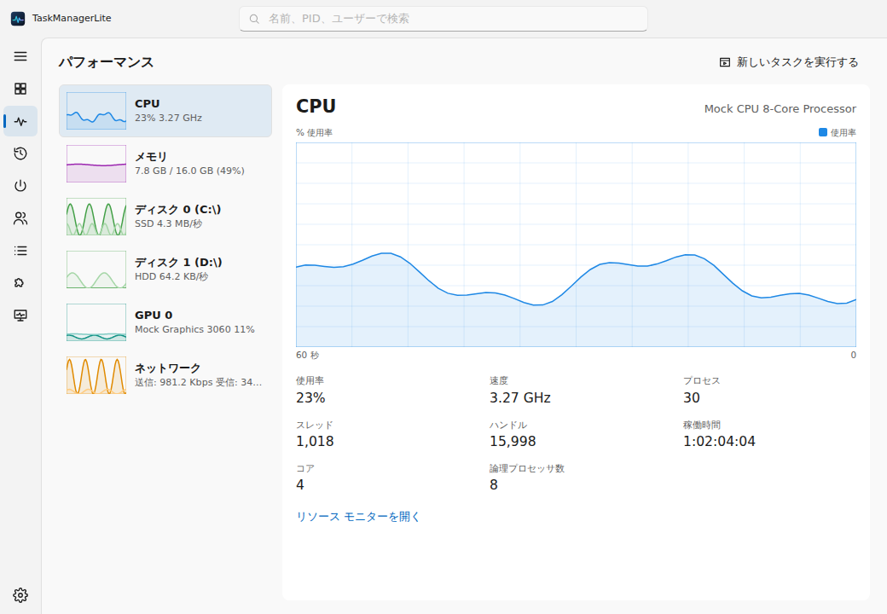
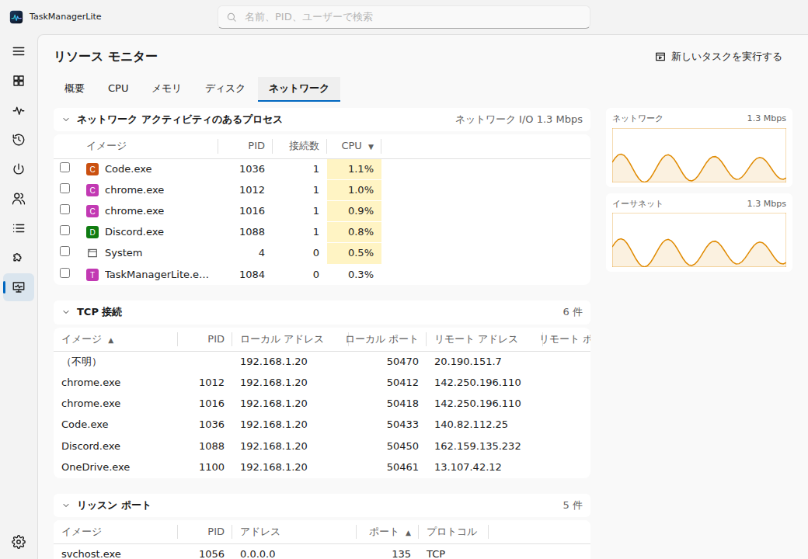
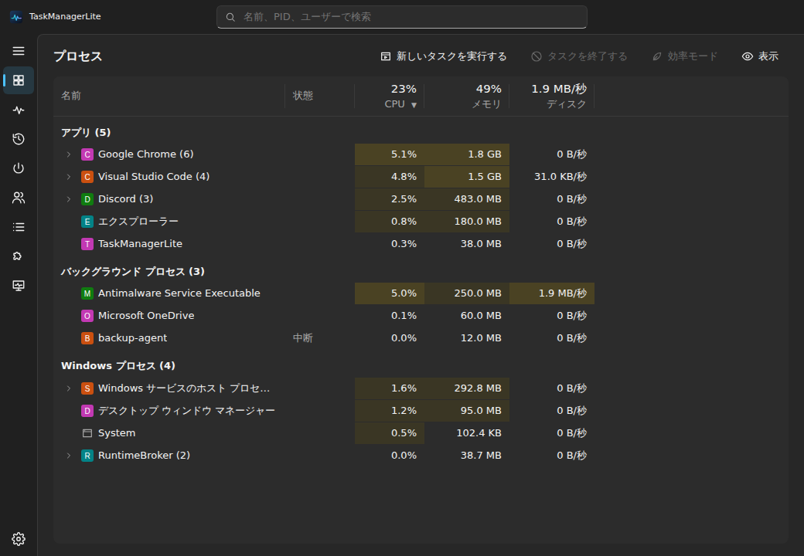

<div align="center">


# TaskManagerLite

**Rust + Tauri + Svelte 5 で作った、軽いタスクマネージャー**

[](https://github.com/valneko-twoon2/TMiL/actions/workflows/ci.yml)
[](https://github.com/valneko-twoon2/TMiL/actions/workflows/codeql.yml)
[](https://github.com/valneko-twoon2/TMiL/releases)
<br>


</div>

---

## 特徴

- **軽い** — ウィンドウを閉じるとトレイに隠れ、その間は計測を止めます
- **見慣れた画面** — Windows 11 のタスク マネージャーと同じ並びのタブとコマンド。奥にあるリソース モニターもサイドバーから開けます
- **Windows と Linux** — スタートアップ アプリは Windows のレジストリと Linux の autostart の両方に対応
- **置き換えられる** — 設定から、タスクバーの右クリックメニューや Ctrl+Shift+Esc で TaskManagerLite が開くようにできます（Windows）
- **ライト・ダーク** — OS の設定に合わせるか、手動で選べます

## 画面

|                                   パフォーマンス                                   |                                リソース モニター                                 |                               ダーク テーマ                                |
| :--------------------------------------------------------------------------------: | :------------------------------------------------------------------------------: | :------------------------------------------------------------------------: |
|  |  |  |

## できること

| ページ                | 内容                                                                                             |
| --------------------- | ------------------------------------------------------------------------------------------------ |
| プロセス              | アプリ・バックグラウンド・Windows プロセスに分けて表示。列を選べ、効率モードや切り替えもできます |
| パフォーマンス        | CPU（論理プロセッサごとも）・メモリ・ディスク・GPU・ネットワークのグラフと詳細                   |
| アプリの履歴          | アプリごとの CPU 時間と読み書きの量                                                              |
| スタートアップ アプリ | 自動起動する項目の一覧と、有効・無効の切り替え                                                   |
| ユーザー              | ユーザーごとの使用量と、そのユーザーのプロセス                                                   |
| 詳細                  | 列を選べるプロセスの一覧。優先度・関係・効率モードの設定やサービスへの移動                       |
| サービス              | サービスの一覧と、開始・停止・再起動                                                             |
| リソース モニター     | 本家の resmon と同じタブ。接続・待ち受けポート・モジュール・プロセスの中断と再開                 |
| 設定                  | 既定のページ・更新間隔・テーマ・常に手前に表示・タスク マネージャーの置き換え                    |

どのページからも「新しいタスクを実行する」で、プログラムやフォルダーを開けます（管理者としても実行できます）。

## インストール

コマンド 1 行で入れられます。ダウンロードしたファイルは、リリースの `SHA256SUMS` とハッシュが一致するか確かめてから入れます。管理者権限は要りません。

Windows（PowerShell）:

```powershell
irm https://github.com/valneko-twoon2/TMiL/releases/latest/download/install.ps1 | iex
```

Linux（x86_64）:

```sh
curl -fsSL https://github.com/valneko-twoon2/TMiL/releases/latest/download/install.sh | sh
```

Linux ではアプリを `~/.local/bin/taskmanagerlite` に置き、アプリのメニューに登録します。消すときは `... | sh -s -- --uninstall` です。

[Releases](https://github.com/valneko-twoon2/TMiL/releases) からファイルを直接ダウンロードすることもできます。

| OS      | ファイル                              |
| ------- | ------------------------------------- |
| Windows | `TaskManagerLite_x.y.z_x64-setup.exe` |
| Linux   | `.deb` / `.AppImage`                  |

> [!NOTE]
> タスク マネージャーの置き換えは、Windows のインストーラーでアンインストールすれば自動で元に戻ります（管理者の確認が出ます）。

## 開発

```sh
cd src/frontend      # npm のコマンドはここで実行する
npm install          # 依存関係と git フック
npm run tauri dev    # アプリを起動
npm run dev:mock     # ブラウザだけで画面を確認（偽のバックエンド）
npm run lint         # Lint
npm test             # テスト（並列）
```

必要なものや詳しい手順は [docs/development/01-setup.md](docs/development/01-setup.md) を見てください。

## テスト

単体（同値分割・境界値・回帰）・スナップショット・契約・VRT・E2E（モック / 実アプリ）・ファジングを用意しています。バックエンドは状態機械にまとめ、**TLA+（TLC）で形式検証**しています（[docs/architecture/02-state-machine.md](docs/architecture/02-state-machine.md)）。カバレッジはフロント・バックとも 80% 以上を CI で確認します。

件数の内訳は [docs/testing/03-inventory.md](docs/testing/03-inventory.md) にあります。

## ドキュメント

[docs/README.md](docs/README.md) に一覧があります。
