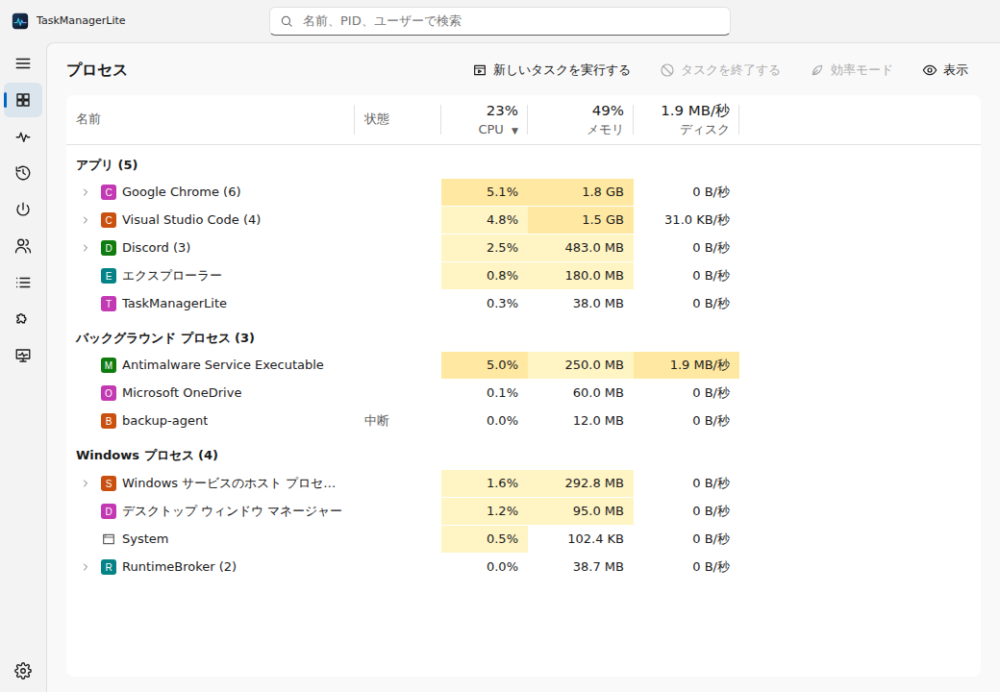

<div align="center">


# TMiL

**Rust + Tauri + Svelte 5 で作った、軽いタスクマネージャー**

[](https://github.com/valneko-twoon2/TMiL/actions/workflows/ci.yml)
[](https://github.com/valneko-twoon2/TMiL/actions/workflows/codeql.yml)
[](https://github.com/valneko-twoon2/TMiL/releases)
<br>




</div>

---

## ✨ 特徴

- 🪶 **軽い** — ウィンドウを閉じるとトレイに隠れ、その間は計測を止めます
- 🪟 **見慣れた画面** — Windows 11 のタスク マネージャーと同じ並びのタブとコマンド
- 🐧 **Windows と Linux** — スタートアップ アプリは Windows のレジストリと Linux の autostart の両方に対応
- 🔁 **置き換えられる** — 設定から、タスクバーの右クリックメニューや Ctrl+Shift+Esc で TMiL が開くようにできます（Windows）
- 🌗 **ライト・ダーク** — OS の設定に合わせるか、手動で選べます

## 📸 画面

|                                   パフォーマンス                                   |                               ダーク テーマ                                |
| :--------------------------------------------------------------------------------: | :------------------------------------------------------------------------: |
|  |  |

## 🧭 できること

| タブ                  | 内容                                                                       |
| --------------------- | -------------------------------------------------------------------------- |
| プロセス              | 実行ファイルごとにまとめて表示。展開して個々のプロセスも確認・終了できます |
| パフォーマンス        | CPU・メモリ・ディスク・ネットワークの 60 秒分のグラフと詳細                |
| スタートアップ アプリ | 自動起動する項目の一覧と、有効・無効の切り替え                             |
| 詳細                  | PID・ユーザー・コマンドラインまで含めた一覧                                |
| 設定                  | 既定のページ・更新間隔・テーマ・タスク マネージャーの置き換え              |

## 📦 インストール

[Releases](https://github.com/valneko-twoon2/TMiL/releases) から入手できます。

| OS      | ファイル                   |
| ------- | -------------------------- |
| Windows | `TMiL_x.y.z_x64-setup.exe` |
| Linux   | `.deb` / `.AppImage`       |

> [!NOTE]
> タスク マネージャーの置き換えは、Windows のインストーラーでアンインストールすれば自動で元に戻ります（管理者の確認が出ます）。

## 🛠 開発

```sh
cd src/frontend      # npm のコマンドはここで実行する
npm install          # 依存関係と git フック
npm run tauri dev    # アプリを起動
npm run dev:mock     # ブラウザだけで画面を確認（偽のバックエンド）
npm run lint         # Lint
npm test             # テスト（並列）
```

必要なものや詳しい手順は [docs/development/01-setup.md](docs/development/01-setup.md) を見てください。

## 🧪 テスト

単体（同値分割・境界値・回帰）・スナップショット・契約・VRT・E2E（モック / 実アプリ）・ファジングを用意しています。バックエンドは状態機械にまとめ、**TLA+（TLC）で形式検証**しています（[docs/architecture/02-state-machine.md](docs/architecture/02-state-machine.md)）。カバレッジはフロント・バックとも 80% 以上を CI で確認します。

件数の内訳は [docs/testing/03-inventory.md](docs/testing/03-inventory.md) にあります。

## 📚 ドキュメント

[docs/README.md](docs/README.md) に一覧があります。
