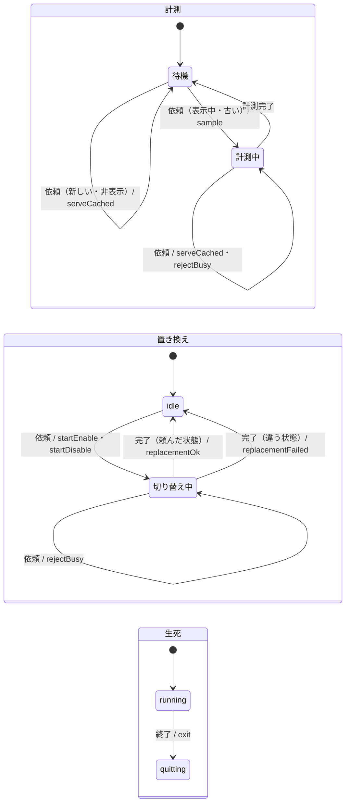

# バックエンドの状態機械と形式検証

バックエンドの判断はすべて 1 つの状態機械にまとめています。その状態機械が守るべきことは、TLA+ で検査しています。

## 構成

| 層       | 場所                                  | 役割                                                                               |
| -------- | ------------------------------------- | ---------------------------------------------------------------------------------- |
| 状態機械 | `src/backend/core/src/machine/mod.rs` | `step(状態, 出来事) → (次の状態, 行うこと)`。純粋関数で、ここだけが判断する        |
| 殻       | `src/backend/core/src/backend/mod.rs` | 出来事を伝え、返ってきた「行うこと」（計測・プロセスへの操作・UAC など）を実行する |
| Tauri    | `src/backend/app/`                    | コマンドとトレイから殻を呼ぶだけ                                                   |
| 仕様     | `tests/formal/BackendMachine.tla`     | `step` と同じ判断をする TLA+ の `Step`                                             |
| 検査     | `tests/formal/Backend.tla`            | 環境と組み合わせて性質を検査する                                                   |

状態を持たない処理（スタートアップ一覧、システム情報など）は状態機械を通しません。

## 状態

状態は 6 つの値の組で、全部で 192 通りあります。そのうち「別のアプリが置き換えていると分かっているのに切り替え中」の 32 通りには届きません（Rust のテストで確かめています）。

| 値       | 取りうる値                    | 意味                                              |
| -------- | ----------------------------- | ------------------------------------------------- |
| window   | visible / hidden              | ウィンドウの表示                                  |
| life     | running / quitting            | 終了処理中か                                      |
| sampling | true / false                  | 計測中か（同時に 1 つだけ）                       |
| cached   | true / false                  | 直前の計測結果を持っているか                      |
| registry | unknown / none / tmil / other | タスク マネージャー置き換えの、最後に確かめた状態 |
| pending  | idle / enable / disable       | 置き換えの切り替え中か                            |

## 主な判断

| 出来事                                       | 判断（上から順に）                                                                                                                                                                                                        |
| -------------------------------------------- | ------------------------------------------------------------------------------------------------------------------------------------------------------------------------------------------------------------------------- |
| 計測の依頼                                   | 終了中なら断る → 計測中なら直前の結果（無ければ断る）→ 非表示なら直前の結果（無ければ断る）→ 前回から 400ms 未満なら直前の結果 → それ以外は計測。計測が終わったら成否を受け取り、成功したときだけ「直前の結果あり」にする |
| 置き換えの依頼                               | 終了中・切り替え中・別のアプリが置き換えているなら断る → 切り替えを始める                                                                                                                                                 |
| 置き換えの完了                               | 確かめた状態が頼んだ状態と同じときだけ成功                                                                                                                                                                                |
| プロセスへの操作の依頼（終了・優先度・関係） | 終了中・存在しない・TMiL 自身とその子孫・起動時刻が違う なら断る → 頼まれた操作をする。判断は操作の種類によらない（TLA+ では終了で代表させる）                                                                            |

## TLA+ で確かめていること

CI の「形式検証（TLA+）」が TLC で次の 3 つを確かめます（`npm run test:formal`）。

### 1. Rust と TLA+ が同じ判断をする

Rust のテストが、全状態 × 全出来事（192 × 25 = 4800 通り）の遷移表を `tests/formal/MachineTable.tla` に書き出します。`MachineConformance.tla` は、その全行で TLA+ の `Step` が同じ結果になるかを確かめます。状態・出来事・行うことの種類が両側でちょうど同じであることも確かめます。

### 2. 環境と組み合わせても約束を守る

`Backend.tla` は、状態機械のまわりで次を自由に動かします。

- 利用者の操作
- 画面からの計測の依頼（時間の経過）
- OS のプロセスの終了と起動（PID の再利用を含む）
- UAC の承認・取り消し
- 他のツールによる設定の書き換え

この組み合わせの全状態で、次を検査します。

| 性質                           | 種類     | 内容（これまでに直した不具合）                           |
| ------------------------------ | -------- | -------------------------------------------------------- |
| `Safe`                         | 不変条件 | 下の約束を 1 つも破らない                                |
| ├ sampledWhileHiddenOrQuitting |          | 隠れている・終了中に計測しない（トレイ常駐中に重くなる） |
| ├ overlappingSamples           |          | 計測を重ねない（グラフが跳ねる）                         |
| ├ resampledTooSoon             |          | 間もない依頼で計測し直さない（グラフが跳ねる）           |
| ├ falseReplacementSuccess      |          | 置き換えに失敗したのに成功と言わない（UAC の取り消し）   |
| ├ overlappingElevation         |          | UAC を重ねて出さない                                     |
| ├ overwroteOtherTool           |          | 別のアプリの置き換えを上書き・削除しない                 |
| ├ servedMissingCache           |          | 持っていない計測結果を返さない                           |
| ├ actedWhileQuitting           |          | 終了処理中に計測・終了・切り替えをしない                 |
| ├ killedProtected              |          | TMiL 自身とその子孫を終了しない（画面が落ちる）          |
| └ killedReplacedProcess        |          | PID が再利用された別のプロセスを終了しない               |
| `ElevationConsistent`          | 不変条件 | UAC の処理が動いているのは切り替え中のときだけ           |
| `CacheBeliefCorrect`           | 不変条件 | 「直前の結果あり」と思うのは、実際に持っているときだけ   |
| `SamplingCompletes`            | 活性     | 計測は必ず終わる                                         |
| `ElevationCompletes`           | 活性     | 置き換えの切り替えは必ず終わる                           |

### 3. 検査が空振りしていない

`Regressions.tla` は、直した 8 つの不具合をそれぞれわざと `Step` に戻した版です。`tests/formal/regressions/*.cfg` ごとに TLC を回し、期待した約束違反を TLC が見つけることを確かめます。見つからなければ CI が失敗します。

## 状態機械を変えるとき

1. `machine/mod.rs` の `step` を変え、Rust のテストを直す（`regression` と `formal` も）
2. 遷移表を作り直す: `UPDATE_FORMAL=1 cargo test -p tmil-core machine::tests::formal`（`src/backend` で）
3. `tests/formal/BackendMachine.tla` の `Step` を同じ判断に直す
4. 新しい約束があれば `Backend.tla` の `Broken` に足す。不具合を直したときは、その不具合を戻した版を `Regressions.tla` と `regressions/*.cfg`、`scripts/lib/formal.mjs` に足す
5. `npm run test:formal` で確かめる（Java 11 以上と tla2tools.jar が必要）。手元で回せないときは CI に任せる

Rust のテスト（`machine::tests::formal`）でも、同じ約束を全状態 × 全出来事で確かめています。TLC が無い環境でも、Rust 側だけは手元で確かめられます。
